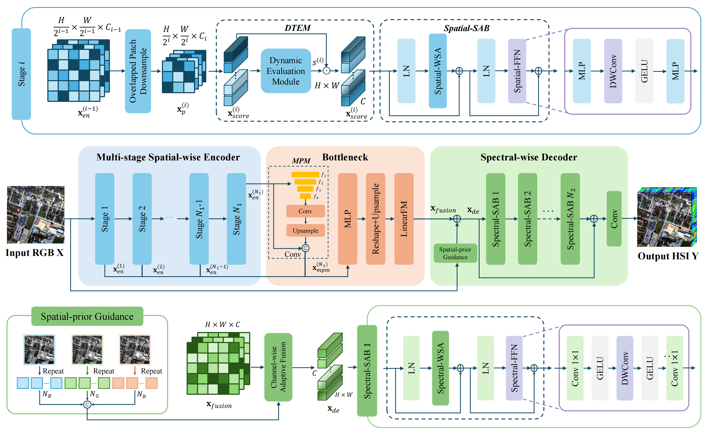

# From Spatial-Guidance to Spectral-Correlation: A Token-Aware Transformer for Hyperspectral Remote Sensing Image Generation

The PyTorch codes are for "**From Spatial-Guidance to Spectral-Correlation: A Token-Aware Transformer for Hyperspectral Remote Sensing Image Generation**", which has been accepted by ***IEEE Transactions on Geoscience and Remote Sensing (TGRS)***, in 2026

## Pipeline




## Environment

Create a virtual environment named `sstat` and activte it.
```bash
conda create -n sstat -c conda-forge python=3.11 gdal=3.13.1 numpy=2.4.6
conda activate sstat
```

Install PyTorch and the matching torchvision build for your system. Then install the remaining dependencies and check that CUDA and GDAL are available.

```bash
python -m pip install timm einops opencv-python-headless wandb
```

## Preparation

Prepare the dataset with the following directory structure.

```text
data/
├── train/
│   ├── multi/
│   └── hyper/
└── test/
    ├── multi/
    └── hyper/
```

Each RGB-HSI pair should share the same lowercase `.tif` filename. Training validation uses the paired files under `test/`.

## Training

The following command uses the training settings reported in the paper.

```bash
python train.py \
  --data_root ./data/DFC2018 \
  --outf ./runs/train/ \
  --gpu_id 0 \
  --batch_size 24 --end_epoch 6 --init_lr 4e-4 \
  --patch_size 128 --stride 8
```
- During training, validation reports MRAE, RMSE, PSNR, SAM, and SSIM. 

- Training progress and metrics are tracked in `wandb`. You can customize the logging setup in `train.py` to suit your workflow.

## Testing

Place the SSTAT checkpoint at `checkpoints/sstat.pth`.

```bash
python test.py \
  --data_root ./data/DFC2018 \
  --pretrained_model_path ./checkpoints/sstat.pth \
  --outf ./results \
  --gpu_id 0
```

- Generated results are saved as GeoTIFFs in `./results/test/` with the same filenames as the inputs.
- If you would like to evaluate performance on the test set, please compute the metrics separately.

## Acknowledgments

The structure of this codes mainly referred to R2HGAN and MSFN. We thank the authors for making these excellent works publicly available.

## Contact
If you have any questions or suggestions, please feel free to contact me.

Email: liuxinyang_sara@buaa.edu.cn

## Citation
If you find this paper helpful in your research, please consider citing it. The formal citation format will be updated after the paper is officially published.
```
@ARTICLE{11783074,
  author={Liu, Xinyang and Liu, Liqin and Zou, Zhengxia and Shi, Zhenwei},
  journal={IEEE Transactions on Geoscience and Remote Sensing}, 
  title={From Spatial-Guidance to Spectral-Correlation: A Token-Aware Transformer for Hyperspectral Remote Sensing Image Generation}, 
  year={2026},
  volume={},
  number={},
  pages={1-1},
  doi={10.1109/TGRS.2026.3751407}}

```
